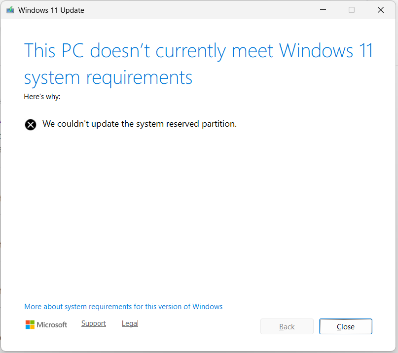

# Fix: "We Couldn't Update the System Reserved Partition" (Windows 11)

[](https://www.microsoft.com/windows)
[](LICENSE)
[]()

A comprehensive troubleshooting guide and automated script suite to fix the Windows 11 Update error:

> **"This PC doesn't currently meet Windows 11 system requirements"**  
> **Here's why:**  
> **(X) We couldn't update the system reserved partition.**



---

## 🔍 Root Cause Analysis

On modern UEFI systems using **GPT (GUID Partition Table)**, the "System Reserved Partition" mentioned by the Windows installer is actually the **EFI System Partition (ESP)** (typically formatted as FAT32, ~100 MB).

### Why the error happens:
1. **Strict Space Requirements:** During major feature updates or upgrades (e.g. Windows 11 23H2 / 24H2), Windows Update requires **at least 15 MB to 20 MB** of free space on the EFI partition to stage bootloader binaries, winpe, and update the Boot Configuration Data (BCD).
2. **Tiny Default Partition Size:** Most OEM laptops (Lenovo, Dell, HP, ASUS, etc.) ship with a default EFI partition size of only **100 MB**.
3. **Hidden Bloat:**
   * **Boot Fonts:** Windows places localized language font files (`chs_boot.ttf`, `cht_boot.ttf`, etc.) into `\EFI\Microsoft\Boot\Fonts`, consuming 10 MB to 40 MB.
   * **OEM BIOS Flasher Leftovers (Very Common on Lenovo / Insyde):** Firmware update utilities (such as Lenovo Vantage or Windows Update firmware drivers) often stage BIOS capsule files or backup dumps directly on the EFI partition and abandon them:
     * `\EFI\Insyde\isflash.bin` (~**34 MB**)
     * `\EFI\Lenovo\BIOS\SelfHealing.fd` (~**32 MB**)
   * Together, these two files alone consume **~66 MB (70%)** of the 100 MB partition, leaving the free space below 2–9 MB and completely blocking Windows updates.

---

## ⚡ Quick Start: 1-Click Fix

We provide automated, safe PowerShell scripts that automatically elevate, back up non-essential files, free the space, and unmount the partition.

### Option A: Automated Fix (Recommended)

1. Download or clone this repository.
2. Right-click **`Fix-EFI-SystemPartition.bat`** and select **Run as administrator**.
3. Click **Yes** on the Windows User Account Control (UAC) prompt.
4. The script will:
   * Mount the hidden EFI partition to `Y:`.
   * Create a full backup of any removed files into `C:\EFI_Backup\`.
   * Reclaim space by safely clearing unused boot fonts (`.ttf`).
   * Detect and remove leftover OEM BIOS flash files (`isflash.bin`, `SelfHealing.fd`).
   * Configure `HKLM\SYSTEM\CurrentControlSet\Control\Bfsvc\EspPaddingPercent` to `0` to prevent installer over-padding checks.
   * Cleanly unmount the drive.
5. Return to the Windows 11 Update window, click **Back**, and click **Next / Install**.

---

## 🛠️ Step 2: Diagnostic Tool

If you want to inspect what is consuming space on your EFI partition before making changes:

1. Right-click **`Inspect-EFI.bat`** and select **Run as administrator**.
2. It prints:
   * Total partition size and free space.
   * Size breakdown for each directory under `\EFI`.
   * The top 15 largest individual files on the partition.

---

## 📖 Manual Fix (Step-by-Step)

If you prefer to perform the fix manually without running scripts, open an **Administrator Terminal / Command Prompt** (`Win + X` > *Terminal (Admin)*) and run:

### 1. Mount the EFI partition
```cmd
mountvol Y: /s
```

### 2. Back up and clean language boot fonts (Microsoft KB3086249)
```cmd
if not exist "C:\EFI_Backup\Fonts" mkdir "C:\EFI_Backup\Fonts"
copy /y "Y:\EFI\Microsoft\Boot\Fonts\*.ttf" "C:\EFI_Backup\Fonts\"
del /f /q "Y:\EFI\Microsoft\Boot\Fonts\*.ttf"
```

### 3. Check and clean OEM flasher leftovers (Lenovo / Insyde)
```cmd
if exist "Y:\EFI\Insyde\isflash.bin" (
    mkdir "C:\EFI_Backup\Insyde"
    copy /y "Y:\EFI\Insyde\isflash.bin" "C:\EFI_Backup\Insyde\"
    del /f /q "Y:\EFI\Insyde\isflash.bin"
)

if exist "Y:\EFI\Lenovo\BIOS\SelfHealing.fd" (
    mkdir "C:\EFI_Backup\Lenovo\BIOS"
    copy /y "Y:\EFI\Lenovo\BIOS\SelfHealing.fd" "C:\EFI_Backup\Lenovo\BIOS\"
    del /f /q "Y:\EFI\Lenovo\BIOS\SelfHealing.fd"
)
```

### 4. Adjust the registry space padding
```cmd
reg add "HKLM\SYSTEM\CurrentControlSet\Control\Bfsvc" /v "EspPaddingPercent" /t REG_DWORD /d 0 /f
```

### 5. Dismount the partition
```cmd
mountvol Y: /d
```

---

## 🛡️ Safety & FAQ

#### Q: Will deleting `.ttf` files break Windows boot?
**No.** The core Windows boot manager (`bootmgfw.efi`) has built-in fallback English bitmap fonts. The `.ttf` files in the boot directory are only supplementary display fonts for different languages. Windows Update will restore any font required for your primary language during the update.

#### Q: Is it safe to delete `isflash.bin` and `SelfHealing.fd`?
**Yes.** 
* `isflash.bin` is a temporary firmware payload from an old BIOS flash. Once your BIOS has been flashed, this file is inactive and no longer needed.
* `SelfHealing.fd` is an old backup copy created during a previous update.
* Both files are verified and backed up to `C:\EFI_Backup\` before deletion, so you have a complete copy preserved on your primary drive.

#### Q: Why is `Local Disk (Y:)` showing in File Explorer?
When you mount the partition with `mountvol Y: /s`, Windows assigns the drive letter `Y:`. Running `mountvol Y: /d` unmounts it cleanly.

---

## 📜 License
This project is licensed under the [MIT License](LICENSE).
